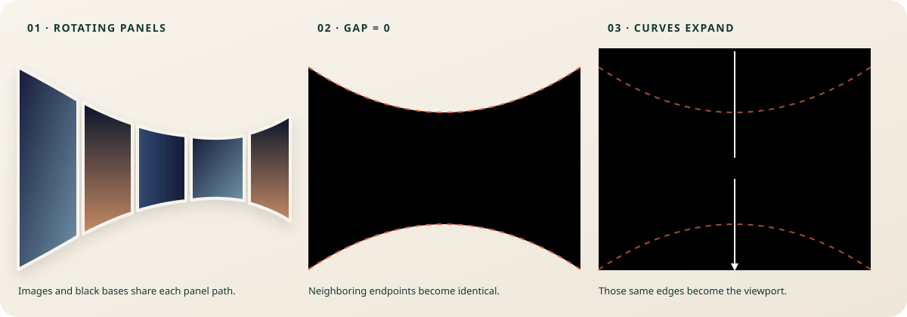

# Unified carousel baseline and geometry

This document completes the discovery and geometry-design phases for the carousel rebuild. It describes the existing visual target and the single surface model that will replace the current CSS 3D carousel plus SVG blackout overlay.



The idle geometry is implemented separately from the production hero at `/unified-carousel-preview.html`. Add `?frame=compact` to inspect the same component inside a 390 px-wide container.

## 1. Current visual baseline

The desktop reference was measured at a 1440 × 675 CSS-pixel viewport with a device-pixel ratio of 2.

| Property | Current value |
| --- | --- |
| Image count | 12 |
| Source image widths | 700 px |
| Source image heights | 911–1244 px |
| CSS card size | 280 × 400 px |
| CSS card aspect ratio | 7:10 with `object-fit: cover` |
| Card radius | 24 px at the desktop reference |
| Angular step | 30° |
| Ring radius | 552.34 px |
| Scene perspective | 560 px |
| Orbit duration | 32 seconds, linear and infinite |
| Visible desktop panels | Approximately 7–8, including cropped edge panels |
| Center projection | Approximately 141 × 203 px |
| Large edge projection | Approximately 278 × 497 px |

The visual signature to preserve is the concave tunnel effect: panels are smallest near the center and become progressively larger toward the viewport edges. The center of the carousel is aligned to the center of the viewport.

### Existing interaction timing

| Phase | Timing |
| --- | --- |
| Images turn black | 700 ms from the click |
| Cards widen and lose their radius | Starts at 620 ms and lasts 900 ms |
| Separate blackout shape appears | Starts at 1500 ms |
| Separate blackout fills the page | 1200 ms |

### Existing responsive behavior

- The scene always matches the viewport height and is capped at 105 rem wide.
- The card and ring geometry do not scale at the mobile breakpoint; the narrower viewport crops more of the same carousel.
- At widths up to 42 rem, the text layout changes and body scrolling is enabled, but the carousel math stays unchanged.
- A resize remounts the carousel after a 250 ms settling period.

### Structural limitation being removed

The current ring radius is almost equal to the perspective distance. Panels on the near half of the CSS 3D ring therefore approach the perspective plane and produce extremely large offscreen bounds. The browser clips those bounds into an attractive arc, but the result is not a stable surface that can be morphed into the viewport.

The blackout is also a second shape in a different coordinate system. Even if it is closely aligned at one viewport size, its first frame cannot be identical to the union of the cards at every size.

## 2. Unified geometry model

The replacement will use a viewport-sized SVG whose viewBox matches the measured container in CSS pixels:

```text
viewBox = 0 0 W H
center = (W / 2, H / 2)
```

All four states—rotating panels, black panels, joined band and fullscreen black—will be drawn from the same set of panel paths.

### Core dimensions

```text
N = 12
angularStep = 2π / N
cardHeight = clamp(360, 0.59 × H, 420)
radius = 1.38 × cardHeight
perspective = radius
idleGapAngle = 0.032 radians
idleCornerRadius = clamp(16, 0.035 × cardHeight, 24)
```

Deriving the radius from card height preserves the current proportions on desktop. On narrow screens it deliberately keeps the carousel large and lets the viewport crop the sides, matching the present art direction instead of shrinking all twelve cards into view.

### Bounded cylindrical projection

For an angle `θ` measured from the far center of the cylinder:

```text
scale(θ) = perspective / (perspective + radius × cos(θ))
x(θ) = W / 2 + radius × sin(θ) × scale(θ)
top(θ) = H / 2 - cardHeight / 2 × scale(θ)
bottom(θ) = H / 2 + cardHeight / 2 × scale(θ)
```

At the center, `scale(0) = 0.5`; at ±90°, the scale reaches 1. This reproduces the measured relationship between the small center panels and the larger edge panels.

Only the visible far arc is rendered. Its overscanned angular limit is:

```text
overscan = 0.35 × cardHeight
θmax = min(0.64π, 2 × atan((W / 2 + overscan) / radius))
visible range = [-θmax, θmax]
```

This range extends the black surface beyond both viewport edges while never approaching the cylindrical projection singularity.

### Panel paths

Each card occupies an angular interval around its orbit position:

```text
gap = idleGapAngle × (1 - mergeProgress)
halfSpan = (angularStep - gap) / 2
leftAngle = panelAngle - halfSpan
rightAngle = panelAngle + halfSpan
cornerRadius = idleCornerRadius × (1 - mergeProgress)
```

The projected top and bottom curves are sampled at the same angles for every neighboring panel. Adjacent endpoints are therefore numerically identical when `gap = 0`. The joined result is a real continuous band rather than a separate layer fitted over the cards.

Each path contains:

1. The shared projected top curve from `leftAngle` to `rightAngle`.
2. The right edge.
3. The same projected bottom curve in reverse.
4. The left edge.

Idle corners are rounded inside the path generator. The radius reaches zero at exactly the same time as the gap, so the panels meet without seams or overlapping rounded corners.

### Images and blackening

Every panel path always has a black fill. Its photograph is rendered inside the same path using an SVG clip path or pattern:

```text
panel fill = black
image opacity = 1 - blackProgress
```

Turning black changes only the image opacity; it does not introduce or swap to another shape.

### Expansion from the curve

Once the gap and corner radius reach zero, every point on the existing top and bottom curves expands toward its corresponding viewport edge:

```text
expandedTop(θ) = lerp(top(θ), -2, expandProgress)
expandedBottom(θ) = lerp(bottom(θ), H + 2, expandProgress)
```

The horizontal panel boundaries remain shared and overscanned. At `expandProgress = 1`, the same panel paths form adjacent fullscreen strips covering the entire viewport. There is no overlay reveal and no geometry handoff.

Because the center starts farther from the viewport edges than the outer portions of the arc, it travels farther during the expansion. Visually, the inward curve opens outward until it becomes the top and bottom of the screen.

### Animation state

The component owns four independent progress values:

| Value | Purpose |
| --- | --- |
| `orbitPhase` | Rotates image ownership around the cylindrical arc while idle |
| `blackProgress` | Fades the photographs, exposing each path's black base |
| `mergeProgress` | Closes angular gaps and removes corner radii |
| `expandProgress` | Moves the shared top and bottom curves to the viewport edges |

Proposed first-pass sequence:

| Time after click | Action |
| --- | --- |
| 0–120 ms | Decelerate and freeze the current orbit phase |
| 0–650 ms | Fade images to black |
| 650–1450 ms | Close gaps and remove corner radii |
| 1450–2650 ms | Expand the joined paths to the viewport edges |

The phases are intentionally sequential so each design beat remains legible. These timings are tuning values, not geometry dependencies.

The sequence position is normalized from 0 to 1 and can travel in either direction. Reversing from any point retraces the current geometry without resetting: the surface contracts, panels separate, photographs return, and idle rotation resumes at position 0.

### Rendering and accessibility boundaries

- Geometry calculations will be pure functions, separate from React rendering and animation timing.
- The SVG will remain decorative inside the existing labelled carousel region.
- A visually hidden list will preserve the twelve image descriptions for assistive technology.
- The existing hero content, button and image files remain unchanged.
- Reduced motion will retain the same state order with short fades and no continuous orbit.

## Acceptance checks before integration

- The idle desktop silhouette matches the current concave arc and shows roughly seven panels.
- Narrow viewports crop the carousel rather than shrinking every panel.
- At `mergeProgress = 1`, adjoining path coordinates are identical to subpixel precision.
- Starting expansion produces no new element, color, edge or opacity change.
- At `expandProgress = 1`, the panel union covers at least `[-2, W + 2] × [-2, H + 2]`.
- Repeated resize calculations produce the same geometry without remounting the component.
